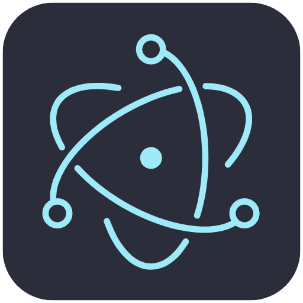

<p align="center">
  
</p>

<h1 align="center">Kimi Dock</h1>

<p align="center">
  <b>Desktop dock for <a href="https://kimi.ai">Kimi AI</a> on a Kimi Code Plan subscription</b><br>
  OAuth device-flow login · Sandboxed webview · arm64 deb with AppArmor
</p>

<p align="center">
  <a href="https://github.com/heni/kimi-dock/blob/main/LICENSE">
    
  </a>
  
  
  
</p>

<p align="center">
  <a href="#features">Features</a> •
  <a href="#installation">Installation</a> •
  <a href="#usage">Usage</a> •
  <a href="#keyboard-shortcuts">Shortcuts</a> •
  <a href="#development">Development</a> •
  <a href="#relationship-to-upstream">Upstream</a>
</p>

---

## Features

### Kimi Code Plan login (no API keys)

- **OAuth 2.0 Device Authorization Grant** against your [Kimi Code Plan](https://www.kimi.com)
  subscription — the app calls `api.kimi.com/coding/v1`, not the pay-per-token
  Moonshot Open Platform.
- **Token isolation** — the OAuth token lives only in the main process
  (`~/.config/kimi-dock/kimi-code.json`, mode 0600). The renderer never sees
  it; all API calls go through a validated IPC proxy.
- **Model picker** — the coding model list is fetched at login and selectable
  in Settings → Kimi Account.

### Kimi AI in a sandboxed webview

- **Native wrapper** — frameless window, system tray, `kimi://` deep links,
  window state persistence, desktop notifications.
- **Chromium sandbox kept on** — the webview runs sandboxed, and the deb
  ships an AppArmor profile granting `userns` to the binary (the pattern
  Ubuntu uses for its own Chromium package), so the sandbox survives on
  Ubuntu ≥ 23.10 without setuid helpers.
- **Strict CSP** — content security policy enforced for the webview and the
  shell, limited to the `kimi.ai`/`kimi.com`/`api.kimi.com` origins.

### Resilient chat

- **Auto-recovery** — automatic reload with backoff when the webview fails to
  load.
- **Local chat** — an offline-mode chat view that talks to the Kimi Code API
  through the same OAuth session.
- **Conversation history** — conversations are stored locally (IndexedDB),
  searchable from the sidebar; import/export as JSON in Settings.
- **Offline access to history** — past conversations stay readable and
  searchable without network. Sending messages requires network (they go
  through the Kimi Code API).

### Clipboard bridge

- Renderer code can read the system clipboard as **plain text, native HTML,
  rich text (RTF returned as an HTML fragment), or images (data URLs)**, and
  write text/HTML/images back — through two enum-restricted IPC handlers in
  the main process. Writes are size-capped and failed image decodes are
  reported.

## Installation

Kimi Dock targets **Linux** and ships as a `.deb`. Build it from source:

```bash
git clone https://github.com/heni/kimi-dock.git
cd kimi-dock
npm ci
npm run build:linux        # → dist/kimi-dock_<version>_arm64.deb (host arch)
sudo apt install ./dist/kimi-dock_*_arm64.deb
```

The package is **architecture-specific**: it bundles a native Electron
binary, so an arm64 `.deb` does not run on x86_64. To build for another
architecture from any Linux host, pass it to electron-builder:

```bash
npm run build && npx electron-builder --linux deb --x64   # → dist/kimi-dock_<version>_amd64.deb
```

No native npm dependencies are involved (`npmRebuild: false`), so the
cross-build needs no extra toolchain. Note that an x64 package built on an
arm64 host cannot be launched there — verify it on the target machine.

The package's postinst installs the AppArmor profile
(`/etc/apparmor.d/kimi-dock`) and reloads it, so the Chromium sandbox works
out of the box; prerm removes the profile on uninstall.

Runtime dependencies are the usual Electron/X11 set (GTK 3, libnotify,
libnss3, libasound2, …) and are declared as deb dependencies.

## Usage

1. Launch **Kimi Dock** — the main window shows the Kimi AI web app.
2. Open **Settings → Kimi Account** and start the device-flow login: the app
   shows a verification URL and a user code; authorize in your browser.
3. Pick a coding model in the same tab.
4. Chat normally; conversations are saved locally and appear in the sidebar
   (`Ctrl+Shift+S`).

Data controls (Settings → Privacy): clear cache, cookies, conversation
history, or everything — the OAuth session is cleared with "all data".

## Keyboard shortcuts

| Shortcut | Action |
|----------|--------|
| `Ctrl + ,` | Open Settings |
| `Ctrl + Shift + S` | Toggle conversation sidebar |

## Development

```bash
npm ci               # install (rebuilds native deps)
npm run dev          # dev mode with HMR
npm run check        # typecheck + lint + build
npm run test:e2e     # Playwright smoke: shell, OAuth session, webview, clipboard
```

`test:e2e` launches the built app against your real desktop session: the
Chromium sandbox must be allowed to start (on Ubuntu ≥ 23.10 install the
AppArmor profile from `packaging/apparmor/` for the dev Electron binary —
same content as the deb ships), and the OAuth check expects a logged-in
session in `~/.config/kimi-dock`.

### Architecture

Three processes, data flowing one way: renderer → preload → main.

```
src/
├── main/            # main process: window, tray, IPC handlers, CSP
│   ├── index.ts     #   app shell + validated IPC surface
│   ├── kimi-oauth.ts#   Kimi Code OAuth device flow + token lifecycle
│   └── clipboard.ts #   clipboard read (text/HTML/RTF→HTML/image),
│                      #   write (text/HTML/image)
├── preload/         # contextBridge: the only renderer→main API (window.api)
└── renderer/        # React shell: title bar, webview, local (offline) chat,
                     # settings
```

Security posture: context isolation on, node integration off, renderer
sandboxed; every payload-bearing IPC handler validates its input; the API
proxy accepts no path other than `GET`/`POST /chat/completions`; files under
`userData` are resolved and confined to that directory.

## Relationship to upstream

Kimi Dock is a fork of [Virusilvester/kimi-desktop](https://github.com/Virusilvester/kimi-desktop)
(MIT). The fork replaces the upstream Moonshot API-key mode with Kimi Code
Plan OAuth, hardens the renderer-to-main bridge, adds the clipboard bridge,
and packages for Ubuntu arm64 with AppArmor. Upstream remains the base for
webview-wrapper behavior; non-fork-specific fixes are intended to be
contributed back. Pre-3.0.0 history is upstream's — see
[CHANGELOG](./CHANGELOG.md).

## License

[MIT](./LICENSE)
